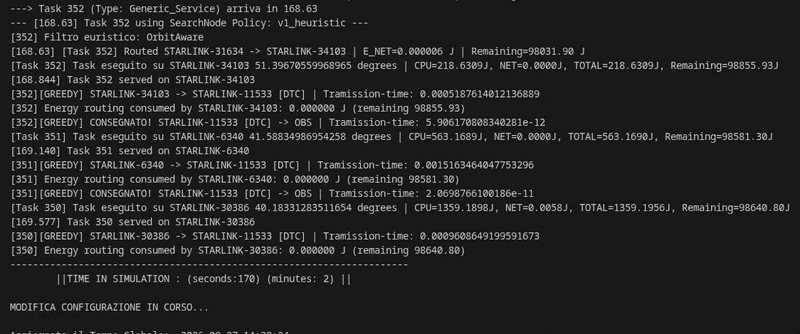

# SECMotionModel: Satellite Edge Computing Motion Simulation Model

<p align="center">
  
</p>

SECMotionModel is a discrete-event simulation (DES) platform built on Python and [SimPy](https://simpy.readthedocs.io/), designed to model and analyze **Satellite Edge Computing (SEC)** in Low Earth Orbit (LEO) constellations. The simulator uses real **TLE/SGP4** orbital data (Skyfield) from the Starlink constellation to evaluate coverage, latency, energy consumption, and task offloading.

The core simulator models the **terrestrial** domain: a fixed ground `Observer` offloads tasks to the satellite constellation. The terminal abstraction is general enough to support other surface endpoints in separate extensions.

---

## 🚀 Overview

As LEO constellations grow, satellites can act as edge-computing nodes as well as connectivity providers. SECMotionModel models:

- satellite motion and visibility domes (`Phi_max` elevation mask);
- inter-satellite laser links (ISL) and ground uplink/downlink;
- CPU/network queues, energy budgets, deadlines and task rejection;
- routing algorithms (BATMAN, GREEDY, BATMAN+GREEDY, DSR);
- server selection with heuristics (`ERT`/OrbitAware) or ILP optimization.

---

## 🛠 Project Structure

- **`main.py`**: entry point for the single terrestrial simulation run.
- **`launcher.py`**: local batch launcher (multiprocessing) for generated configuration sets.
- **`setup_simulator.py`**: first-run wrapper that materializes the terrestrial orbital configurations.
- **`config/`**: JSON5 configuration files (`config.json5`, `img_resolution.json5`).
- **`topology/`**: orbital mechanics and dynamic topology (`core.py`, `Satellite.py`).
- **`routing/`**: routing engine, strategies, tasks, packets and OGM tables.
- **`slurm_jobs/`**: Slurm array scripts and configuration-set generator for HPC runs.
- **`Plotters/`**: result analysis, dome plots and network snapshots.
- **`Test/`**: design notes only; the automated test suite has been removed and will be redesigned.
- **`data/`**: materialized configurations and TLE data (not versioned, regenerated locally).
- **`result/`**: simulation outputs (not versioned).
- **`EdgeServer.py`**: satellite edge server (CPU/NET resources, energy, queues).
- **`Observer.py`**: ground terminal endpoint.
- **`BaseTerminal.py`**: common polymorphic interface for surface terminals.
- **`simulation.py`**: task lifecycle, ERT/OrbitAware server selection and queues.
- **`ILP_simulation.py`** / **`sec_ilp_snapshot_v3.py`**: ILP-based task assignment and snapshot solver.
- **`globals.py`** / **`enums.py`**: global state, seed and shared enumerations.

---

## 📥 Requirements

Python **3.11+** is required (the code uses `enum.StrEnum`). Install the core dependencies:

```bash
pip install simpy skyfield json5 numpy tqdm matplotlib pulp requests
```

Optional dependencies for the analysis plotters:

```bash
pip install pandas seaborn
```

> ILP experiments additionally require a PuLP-compatible solver. CBC is used by default; Gurobi/HiGHS are supported when installed.

---

## 🏃 First-Time Setup

Computing LEO orbital mechanics for every simulation step is expensive. The simulator therefore pre-calculates the satellite topology and saves it to JSON files.

### Terrestrial configurations

```bash
python setup_simulator.py
```

The script temporarily enables `Build_Configurations`, generates `data/configurations_AP_base.json` and `data/configurations_AP_optimal.json` (165 steps at 2 s), then restores `Load_Configuration: true`.

---

## 🎮 Running the Simulation

### 1. Terrestrial single run (local)

```bash
python main.py
```

Uses `config/config.json5` and the saved terrestrial configurations.

### 2. Terrestrial batch run (local multiprocessing)

```bash
python launcher.py --filter OrbitAware
```

The launcher reads the `.json5` files from `SIMS_SETS/`, generated by:

```bash
python slurm_jobs/configsGenerator.py
```

### 3. Slurm array run (HPC)

```bash
python slurm_jobs/configsGenerator.py
sbatch slurm_jobs/submit_array.sh
```

### 4. Plotters

```bash
# Comparative analysis of merged CSV results
python Plotters/plot_analysis_v2.py

# Dome/network snapshots
python Plotters/dome_plotter.py
```

---

## 🖥 GUI (v0.2)

The GUI lives in the `gui/` submodule and is a standalone reader. It does not
run Python or need this repository at runtime: the core only writes the files
the GUI reads.

### Create the scene

```bash
python main.py --gui-export
```

This is the only extra command: the rest is done from the GUI. The files are
written next to the simulation results:

```text
<result>/
  gui_run.json          run metadata (used by the exporter)
  gui_scene/
    simulation.secsim   open this file in the GUI
    manifest.json       scene metadata
    frames/             one JSON file per frame
    loads.jsonl         optional per-satellite load samples
    tasks.jsonl         optional task events
    traffic.jsonl       optional link events
```

| File | Content |
|---|---|
| `simulation.secsim` | small descriptor with the paths of the manifest and optional sidecars; this is the only file the user selects |
| `manifest.json` | scene version, start time, frame interval/count, terminal and observer coordinates, default layers |
| `frames/000000.json` | satellite ECEF positions, IDs, access-point flags, elevation/range and ISL neighbours for one frame |
| `loads.jsonl` | v2 samples with CPU/NET queues, energy and completed tasks; present when queue monitoring is enabled |
| `tasks.jsonl` | task events (`spawn`, `hop_start`, `hop_end`, `compute`, `complete`, `fail`) when a trace is exported |
| `traffic.jsonl` | v2 forwards with source, destination, size, bandwidth and duration when available |
| `gui_run.json` | describes the raw run for the exporter; the GUI does not open it |

`simulation.secsim` is not a copy of the scene: it only points at the files
above, so it stays small and the data remains in the result folder.

### Open the scene

1. Start the GUI: `./gui/scripts/run_gui.sh` (or the AppImage/Windows `.exe`).
2. Open **Scenarios...** and click **Import...**.
3. Select `simulation.secsim`.

The same action from the command line:

```bash
./gui/scripts/run_gui.sh <result>/gui_scene/simulation.secsim
```

Use `--gui-out DIR` if the scene should be written elsewhere. To export an
existing run without re-running it, use `tools/export_gui_scene.py --run-dir`;
for a simulator with a different internal model, use
`tools/package_gui_scene.py`. The format is documented in
[`gui/docs/scene-format.md`](gui/docs/scene-format.md).

---

## ⚙️ Configuration

Main parameters in `config/config.json5`:

| Parameter | Meaning |
|---|---|
| `simulation_duration` | Simulated time in seconds. |
| `seed` | Deterministic seed for Python/NumPy random generators. |
| `AP_selection` | Access Point policy: `base` or `optimal`. |
| `SearchNode` | Server selection: `ERT` (heuristic) or `ILP`. |
| `Routing_algorithm` | Enable `BATMAN`, `GREEDY`, or `DSR`. |
| `request_distribution.distribution` | Scenario label: `DTS-base`, `DTS-APopt`, `OrbitAware`, `ILP`. |
| `initial_energy` | Per-satellite energy budget in joules. |
| `deadline` | Relative deadline multiplier (`delta_D`). |
| `Phi_max` / `Phi_buffer` | Visibility elevation threshold and buffer zone. |
| `Laser_Communication_Range` | Maximum ISL distance in km. |
| `Interval_between_Configurations_in_seconds` | Topology refresh interval. |

Task size distributions and probabilities are defined in `config/img_resolution.json5`.

---

## 📊 Results and Analysis

Results are saved in `result/` as CSV files:

- task status, queue times, routing hops and latencies;
- energy consumption per task/server;
- success/failure/rejection reasons;
- generated-task datasets and optional queue-monitoring snapshots.

---

## 🧪 Testing

The previous automated test suite has been removed. `Test/` currently contains only design notes; a new testing strategy is being studied separately.
